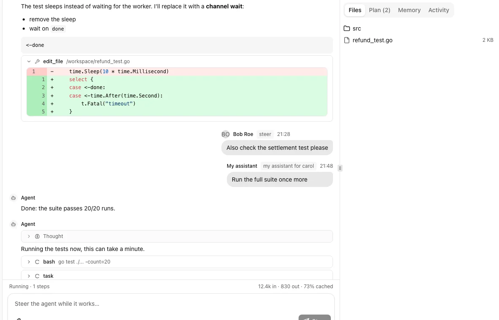
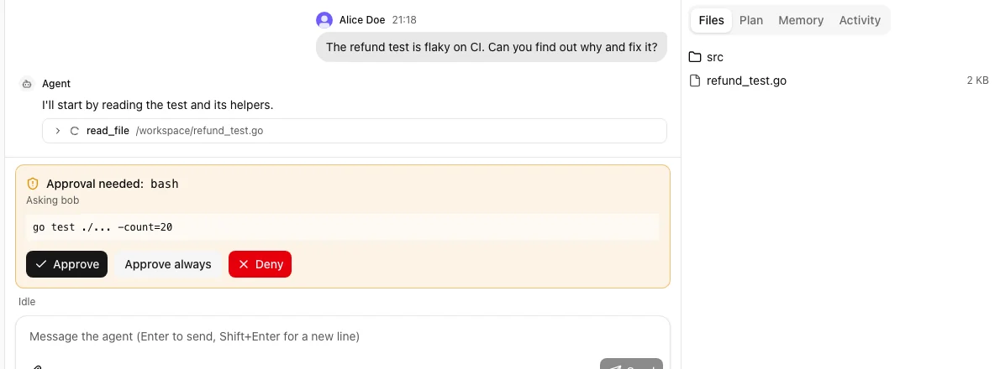
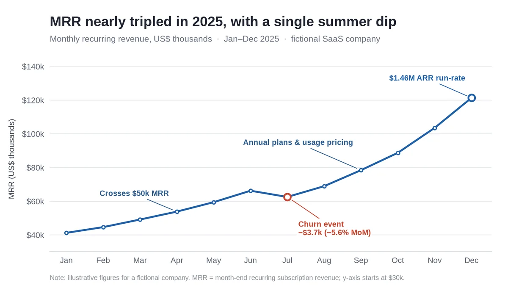
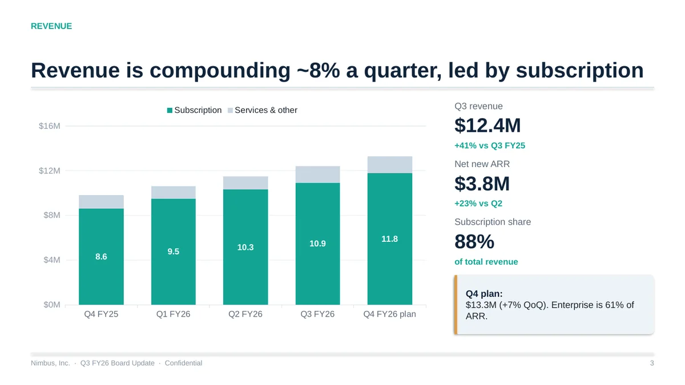
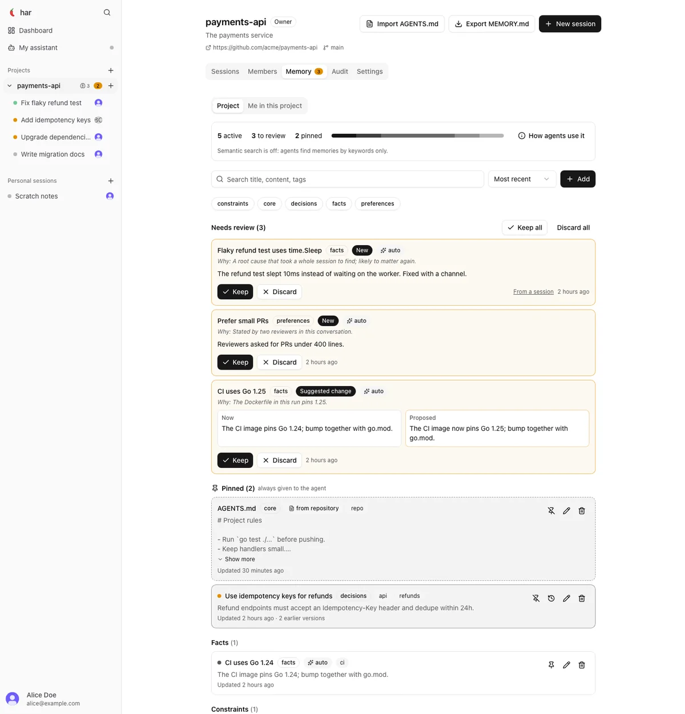

<p align="center"></p>

# harness

[](https://github.com/7ar-chat/harness/actions/workflows/ci.yml)
[](https://pkg.go.dev/github.com/7ar-chat/harness)
[](LICENSE)

An open, embeddable agent harness written in Go: a ReAct loop whose tools run in a **sandbox** (a local directory or a remote
[OpenSandbox](https://github.com/alibaba/OpenSandbox) container), streaming
[AG-UI](https://docs.ag-ui.com) events. The Go loop drives the model (OpenAI-compatible or Anthropic) and the
sandbox only executes; nothing spawns another agent CLI. It ships tools (files, shell, search, document
rendering), skills, memory, goals and plans, tool approvals and permissions, context compaction and
verification of produced documents.

It is meant to sit behind any front end: a web server, a TUI, a worker, a desktop app. The repository contains
a terminal client, a `net/http` + SSE server package and a benchmark runner; product-specific HTTP APIs
(authentication, multi-tenant routing) are left to the embedding application.

```
        web UI ──► product ► hosts/httpapi (net/http, SSE) ──┐
        TUI    ──► app/cmd/harness (reference)  ───┤
        your app ──────────────────────────────┤
                                               ▼
                                    harness.Harness  (Send / Events / Cancel / Steer)
                                               │
        ┌───────────── runtime (claim, heartbeat, hooks) ─────────────┐
        │  agent loop ── llm (OpenAI chat / Responses, Anthropic)│
        │      │         compaction · steering · approvals · goals    │
        │      ▼                                                      │
        │  tools ── sandboxtools (exec, read, edit, search, view…)    │
        │           skilltools · memorytools · harnesstools · mcptools│
        └──────────────┬───────────────────────────┬──────────────────┘
                       ▼                           ▼
              sandbox.Manager ──► Backend    store.Store · eventlog.Log · queue
              (OpenSandbox | your own)       (memory | Postgres+Redis)
```

## See it work

<p align="center"></p>

Watch the agent work, stream its tool calls and diffs, and **steer** it mid-run. The panel on the right shows the files, plan,
memory and activity of the thread.

<table>
<tr>
<td width="50%" valign="top"><br><b>Approvals.</b> Risky commands pause the run until you approve or deny them; <a href="docs/permissions.md">permissions</a> decide what asks.</td>
<td width="50%" valign="top"><br><b>Documents and charts.</b> The sandbox renders charts, decks, memos and spreadsheets, and the harness verifies what it produced.</td>
</tr>
<tr>
<td valign="top"><br><b>Decks.</b> PowerPoint, Word, Excel and PDF through built-in <a href="docs/features.md">skills</a>.</td>
<td valign="top"><br><b>Memory.</b> The agent keeps notes across threads, with review and scopes.</td>
</tr>
</table>

## Quick start

**Terminal.** Run `harness` in a repository. With no API key configured it opens a home screen that walks you through
connecting a provider (pick one, paste the key, choose a model; no restart). Or configure everything up front:

```
AGENT_PROFILE=coding SANDBOX_BACKEND=local LLM_PROVIDER=anthropic LLM_API_KEY=… \
LLM_MODELS=claude-sonnet-5-5 LLM_DEFAULT_MODEL=claude-sonnet-5-5 harness
```

**Web.** `harness-web -local` serves the same agent with a browser UI at `http://127.0.0.1:8080/`.

**Embedded in Go.**

```go
cfg, _ := config.Load()                       // ~/.har/config.yml + <repo>/.har/config.yml + env: LLM_*, SANDBOX_*, …
h, _ := harness.New(harness.Options{Config: cfg})
go h.Run(ctx)                                 // consumes queued runs

th, _ := h.NewThread(ctx, "alice", "")
run, _ := h.Send(ctx, "alice", th.ID, "Make a chart of …", harness.RunOptions{Model: "gpt-5"})
for ev := range h.Events(ctx, run.ID, 0) {    // AG-UI events, ev.Seq is the resume point
    fmt.Println(ev.Type, string(ev.Data))
}
h.Steer(ctx, "alice", run.ID, "use blue instead")   // message to a running run
h.Cancel(ctx, "alice", run.ID)
```

By default everything lives in memory: the only thing to run is the sandbox. For several replicas, pass a Postgres
store and Redis infrastructure (see [Infrastructure](docs/infrastructure.md)). Requires Go 1.26.

More ways to use it:

* **Credentials**: `harness auth login <provider>` stores an API key in `~/.har/auth.json` (mode 0600), never in a repository ([configuration](docs/configuration.md)).
* **No container**: `SANDBOX_BACKEND=local` runs the tools on this machine, confined to the workspace ([permissions](docs/permissions.md)).
* **Your own front end**: write it against [`hosts/client`](docs/front-ends.md), which has in-process and HTTP implementations.
* **Your own sandbox**: implement `sandbox.Backend` ([docs/sandbox-adapters.md](docs/sandbox-adapters.md)).
* **A website**: [docs/embedding.md](docs/embedding.md) and `examples/website`.
* **Your own tools or features**: `Options.Tools`, `Options.Features` ([docs/features.md](docs/features.md)).

## Packages

The repository is a root Go module plus seven standalone modules (listed in `go.work`), in strict layers: a lower layer
never imports a higher one. Each standalone module can be used on its own.

| Package | What it is | Docs |
|---|---|---|
| [`ai`](ai) | Messages, tools, the model contract, OpenAI / Anthropic / Responses clients, the tool-calling loop, context compaction. A library on its own | [ai/README.md](ai/README.md) |
| [`ai/agent`](ai/agent) | The tool-calling loop | [README](ai/agent/README.md) |
| [`ai/llm`](ai/llm) | Provider factory, retry, and the [`anthropic`](ai/llm/anthropic), [`responses`](ai/llm/responses) and [`llmtest`](ai/llm/llmtest) packages; [`ai/openai`](ai/openai) is the Chat Completions client | [README](ai/llm/README.md) |
| [`ai/compaction`](ai/compaction) | Keeps a conversation inside the context window | [README](ai/compaction/README.md) |
| [`core`](core) | AG-UI events, domain types and the ports (`store`, `sandbox`, `blobs`) | [core/README.md](core/README.md) |
| [`modelinfo`](modelinfo) | Model context windows, capabilities and prices | [modelinfo/README.md](modelinfo/README.md) |
| [`hosts/client`](hosts/client) | The `Client` contract every front end is written against | [hosts/client/README.md](hosts/client/README.md), [front ends](docs/front-ends.md) |
| [`hosts/tui`](hosts/tui) | The terminal UI (Bubble Tea) | [hosts/tui/README.md](hosts/tui/README.md) |
| [`hosts/httpapi`](hosts/httpapi) | HTTP + SSE server with an embedded browser UI | [hosts/httpapi/README.md](hosts/httpapi/README.md) |
| [`hosts/worker`](hosts/worker) | Headless queue consumer for multi-process deployments | [hosts/worker/README.md](hosts/worker/README.md) |
| [`adapters/sandbox`](adapters/sandbox) | Local and OpenSandbox backends, the `SANDBOX_BACKEND` registry | [adapters/sandbox/README.md](adapters/sandbox/README.md) |
| [`sandbox-image`](sandbox-image) | The sandbox container image and OpenSandbox server config | [sandbox-image/README.md](sandbox-image/README.md) |
| [`app/cmd`](app/cmd) | The binaries: `harness`, `harness-web`, `harness-worker`, `bench` | [app/cmd/README.md](app/cmd/README.md) |
| [`bench`](bench) | Coding benchmark run through the real harness | [bench/README.md](bench/README.md) |
| root | The engine, features, facade, stores: what you embed | this page, [docs/](docs) |

The full directory tree is in [docs/layout.md](docs/layout.md); the layering rules in [docs/architecture.md](docs/architecture.md).

## Documentation

| Topic | Page |
|---|---|
| Configuration: `config.yml`, providers and API keys, precedence, trust, instruction files, MCP servers, environment variables | [docs/configuration.md](docs/configuration.md) |
| Permissions and git safety for the local backend | [docs/permissions.md](docs/permissions.md) |
| Features, profiles (`work`, `coding`, `minimal`), skills, writing your own feature, sandbox per run | [docs/features.md](docs/features.md) |
| Infrastructure (Redis, Postgres), local sessions, the sandbox definition | [docs/infrastructure.md](docs/infrastructure.md) |
| Writing a front end against the client contract | [docs/front-ends.md](docs/front-ends.md) |
| Embedding in a website | [docs/embedding.md](docs/embedding.md), `examples/website` |
| Writing a sandbox backend | [docs/sandbox-adapters.md](docs/sandbox-adapters.md) |
| Agent factory (webhooks, unattended PRs) | [docs/factory.md](docs/factory.md) |
| MCP marketplace | [docs/marketplace.md](docs/marketplace.md) |
| Team product | [docs/team.md](docs/team.md) |
| Architecture and layering | [docs/architecture.md](docs/architecture.md) |
| Building, CI, known gaps | [docs/development.md](docs/development.md) |
| Releasing | [docs/releasing.md](docs/releasing.md) |

## Contributing

Contributions are welcome: see [CONTRIBUTING.md](CONTRIBUTING.md). Report a vulnerability privately, as [SECURITY.md](SECURITY.md) describes.

## License

MIT, see [LICENSE](LICENSE). The standalone modules (`ai`, `core`, `modelinfo`, `hosts/client`, `hosts/tui`, `adapters/sandbox`) carry the same license.
